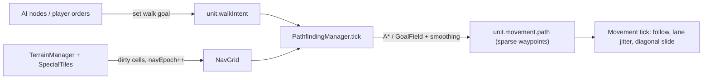

> **Completed 2026-10-02.** Steps 1–12 delivered: isolated `pathfinding/` module (NavGrid with serialized `navEpoch`, line-of-walk, heap A*, lazy shared GoalFields, string-pull smoothing with per-unit corner widening, `PathQuery`, `PathfindingManager` with budgeted/staggered deterministic planning, validation and trimming); movement follows sparse waypoints, slides diagonally round full cells and along walls; every AI tree and pet command sets walk goals through `context.nav`; the legacy pathfinder, `findGridPathForUnit` and the retrigger system are gone. Verify: lint 0 errors (15 pre-existing warnings), tsc clean, `npm run test` 2380 passed / 1 pre-existing skip, all eight pathfinding scenarios plus a cold-cache checkpoint determinism test pass. Pathfinding costs 0.19 ms/tick average at 200 units (≤ 1 ms worst tick after start-up). Workers were Haiku; the orchestrator rewrote or corrected substantial parts of Steps 1–11 on review (see the review notes in each step and the "Implemented API" section). **Follow-ups:** the manual browser checklist in Step 12; AI (~2 ms/tick) and CrowdSpacing (~1.6 ms/tick) dominate the 200-unit frame and are worth a separate pass; large-unit clearance remains deferred.

# Plan: Pathfinding overhaul

Design agreed in chat (2026-10-02). Goal: enemy units stop taking staircase / U-shaped routes, and pathfinding stays inside the frame budget from 1 up to ~200 units.

## Context — why paths look wrong today

| Symptom | Cause (verified by reading code, not by profiling) |
|---|---|
| "Stepping" staircase | AI paths are dense 8-connected cell lists and movement walks cell centre → cell centre (`game/units/unitMovementTick.ts`). Nothing smooths grid paths. |
| U-shapes / trailing kinks | `applyAIMovementToPosition` (`game/units/unitAI/utils.ts`) splices a sub-path from the **old path end** to the new destination, and rotates the destination by a jitter angle. Most enemies also path with an occupancy cost (`GameEngine.buildAIContext → findGridPathWithOccupancyCost`) that detours around crowds. |
| Cost | The occupancy variant is never cached; the A* open set is a linear-scan array with a `find` per neighbour; blocked cells are string-keyed sets; `getCrystalProtectedSet()` is rebuilt per request. |
| Line of sight | `TerrainGrid.hasLineOfSight` and `playerMovePath.isDirectGridLineTraversable` read **bedrock only** (ignore created rocks) and sample cells rather than covering every cell the line touches. |

## Decisions (locked)

| Topic | Decision |
|---|---|
| Location | New isolated folder `app/js/games/minion_battles/pathfinding/`. Nothing in it imports from `game/units/unitAI/` or mutates unit positions. |
| Separation | **AI sets a goal** (`unit.walkIntent`). **`PathfindingManager` turns goals into `unit.movement.path`.** **Movement only follows waypoints.** Movement never searches; pathfinding never moves a unit. |
| Path format | `movement.path` stays `{col,row}[]` but becomes **sparse waypoints** (string-pulled). Checkpoint + order wire formats unchanged. A one-waypoint path = straight line. |
| Unit collisions | Search **ignores other units** — occupancy cost is removed from pathfinding. `CellOccupancyManager` capacity, `CrowdSpacingManager`, and the movement-time **diagonal slide** (`unitCellSlide.ts`) stay and must keep working with sparse waypoints. |
| Tick order | Unchanged (abilities → occupancy → **pathfinding** → movement → crowd spacing → AI). Terrain is frozen for the pathfinding + movement phase. |
| Large units | Deferred. Every unit is assumed to fit a one-cell corridor. Do not add clearance classes. |
| Spreading | No cross-referencing between units. Per-unit `moveJitter` drives (1) left/right tie-break between near-equal routes, (2) corner widening during smoothing, (3) the existing in-cell jitter in movement. |

### Vocabulary

| Term | Meaning |
|---|---|
| **NavGrid** | Typed-array snapshot of passability + integer step cost per **nav profile**, derived from effective terrain. |
| **Nav profile** | `default` (terrain only) or `enemy` (terrain + crystal-protected cells blocked). Chosen from the unit, never stored on it. |
| **navEpoch** | Serialized integer that increments whenever passability/cost of any cell changes for any profile. |
| **Line of walk** | A straight segment is walkable: every cell it touches is passable and it never squeezes diagonally between two blocked cells. |
| **GoalField** | Goal-rooted Dijkstra distance field, expanded lazily, shared by every unit heading for the same goal cell. |
| **Walk goal** | The durable `unit.walkIntent`: chase a unit, or go to a cell / pixel. |

---

## Agent Instructions

This plan is executed by `/jp-implement-plan` (see `.claude/skills/jp-implement-plan/SKILL.md` — do not restate its workflow here). The **invoking agent is the sole orchestrator**: it spawns one worker per step **synchronously** (never in the background), waits for each worker to finish, then moves to the next step, and finally reports plan completion to the user. Each worker implements **exactly one step**, checks off that step's checklist items with a one-line summary under each, and **stops without spawning the next agent**.

Project skills relevant to this plan:

- `working-on-minion-battles` — where game code lives.
- `game-engine` — tick loop, manager wiring, checkpoint serialization.
- `working-on-ai-controllers` — AI trees/nodes (Steps 8–10).
- `game-sync-data-flow` — lockstep / checkpoint restore constraints (read before Steps 1, 6, 7).
- `ability-tests` — scenario definitions and the headless runner.
- `performance-debugging` — perf labels and the stress benchmark (Steps 6, 12).
- `scoped-testing` — per-step Vitest selection.
- `writing-nested-agents-files` — `pathfinding/AGENTS.md` (Step 11).

**Verification cadence:** per step, at most `npm run lint`, `npx tsc --noEmit` when the step crosses an interface boundary, and **only** the test files listed under that step's "Verify". No full-suite, whole-directory, or AbilityTest runner pass inside Steps 1–11. Step 12 runs the expensive checks once.

**Determinism rule (applies to every step).** The sim is deterministic lockstep and clients restore from checkpoints with **empty caches**. Therefore:

- Every path must be a pure function of serialized state: terrain, special tiles, unit position, walk goal, `moveJitter`, `gameTick`, `navEpoch`.
- Caches may only **memoize** — a cache hit and a cold rebuild must return identical results.
- No wall-clock budgets, no `Math.random`, no hidden runtime queues. Scheduling state lives on the unit and is serialized.
- Use **integer costs** (cardinal `10 × weight`, diagonal `14 × weight`, rounded) and break heap ties by `(cost, cellIndex)`.
- Never pick a search strategy based on cache contents or request counts. Strategy is chosen from the goal kind only: **chase-unit goals use GoalField; cell/pixel goals use A\***.

**Content note:** do not reorder tick phases, add large-unit clearance, add path costs for other units, or change order wire types. If a step seems to require one of these, stop and return the question.

---

## Implemented API (kept current by the orchestrator — trust this over the step text where they differ)

After Steps 1–2 (reviewed):

- `terrainManager.nav` — lazy getter returning an always-flushed `NavGrid` (never null). Do **not** construct `NavGrid` yourself or call `flush()`.
- `terrainManager.navEpoch` (serialized), `terrainManager.notifyNavChanged(col?, row?)` (bump epoch + mark dirty), `terrainManager.markNavDirty()` (dirty, no bump — restore only). `clearPathCache()` calls `notifyNavChanged()`.
- `NavGrid`: `width`, `height`, `isPassable(profile, col, row)`, `isPassableIdx(profile, idx)`, `stepCost(profile, idx)` (integer; cardinal step cost into that cell), `sameComponent(profile, idxA, idxB)`, `NAV_IMPASSABLE_COST`. Cell index = `row * width + col`.
- `getNavProfileForUnit(unit)` → `'default' | 'enemy'` (`pathfinding/navProfile.ts`).
- `hasLineOfWalk(nav, profile, x0, y0, x1, y1)` (world px; checks the centre line plus two parallel lines `NAV_AGENT_HALF_WIDTH` = 8px either side), `hasLineOfWalkCells(nav, profile, c0, r0, c1, r1)`, `maxStepCostOnLine(...)` (`pathfinding/lineOfWalk.ts`).
- `aStar(nav, profile, startIdx, goalIdx, side: 0 | 1): number[] | null` — cell-index chain, start excluded, goal included; `[]` if start === goal; `null` if unreachable. Diagonal step cost = `Math.round(stepCost * 1.4)`. `side` 1 is the point reflection of side 0 (opposite tie resolution everywhere, including heap ties via `BinaryHeap.setTieOrder`).
- `BinaryHeap(capacity, keys: Int32Array)`: `clear()`, `push(cell)`, `pop()` (`-1` when empty), `update(cell)`, `has(cell)`, `setTieOrder(descending)`.
- `smoothPath(nav, profile, startX, startY, chain): { col, row }[]` — sparse waypoints, goal last.

After Step 3 (reviewed):

- `checkCellCrossingOccupancy(unit, engine, nextCol, nextRow): boolean` in `game/units/unitCellSlide.ts` replaces `checkNextCellOccupancy`. Called by `updateUnit` whenever this tick's move would enter a different cell. Inserts a slide waypoint at the front of the path (or, for a non-pursuit move whose full cell is the destination, replaces it) and sets `movement.navEpoch = -1`. A pursuer never slides away from its own destination cell.
- `findSlideCell(..., isCellWalkable)` now rejects impassable / corner-cutting candidates.
- `UnitMovement.navEpoch?: number`, `UnitMovement.stopRange?: number`, `UnitWalkIntent.stopRange?: number` exist and are serialized. `unit.setMovement(path, targetUnitId, tick, targetPixel?, stopRange?)`.
- On the last waypoint, a pursuer steers at the target's live position when the target is in the waypoint cell or an adjacent one.

After Step 4 (reviewed):

- `terrainManager.pathQuery` (`pathfinding/PathQuery.ts`): `findPath(fromX, fromY, toCol, toRow, profile, side)` (world-px start; line-of-walk fast path returns `[goal]` with no search; goal snaps to `nearestPassable`), `findCellPath(fromCol, fromRow, toCol, toRow, profile, side)` (memoized per `navEpoch`, returns copies), `isReachable(profile, fromCol, fromRow, toCol, toRow)`, `hasLineOfWalk(profile, x0, y0, x1, y1)`, `nearestPassable(profile, col, row)`, `clearCache()`.
- `terrain/Pathfinding.ts` and `TerrainManager.pathfinder` no longer exist. `TerrainManager.findGridPath*` still exist as delegates and return **sparse** waypoints.
- Tests that mutate `tm.grid.set(...)` after the nav grid exists must call `tm.clearPathCache()`.
- Scenario helpers in `testing/scenarios/general/pathfinding.ts`: `spawnRouteChaser`, `queuePlayerWaits`, `trackRoute` (reuse them for new route scenarios).

After Step 5 (reviewed):

- `pathfinding/search/neighbours.ts`: direction tables per side + `stepMoveCost(cellCost, diagonal)`.
- `GoalField(nav, profile, goalIdx)`: `ensureSettled(cell)`, `distance(cell)` (`-1` unreachable), `extractChain(fromIdx, side)`, `expandedCount`. Resumable; results proven independent of query order and of lazy vs full expansion.
- `pathQuery.findPathToSharedGoal(fromX, fromY, goalCol, goalRow, profile, side)` — same contract as `findPath` but uses a cached `GoalField` (LRU of `GOAL_FIELD_CACHE_SIZE` = 16, cleared on `navEpoch` change); `pathQuery.goalFieldCount`.
- `hasLineOfWalk(nav, profile, x0, y0, x1, y1, halfWidth = NAV_AGENT_HALF_WIDTH)` — pass `0` to test the centre line only (path re-validation).

After Step 6 (reviewed; manager tests rewritten by the orchestrator, incl. a cold-cache checkpoint determinism test that passes):

- `unit.setWalkGoal(goal: UnitWalkGoal)` — `{ kind: 'unit', unitId, col, row, stopRange? }` (col/row = target's current cell) or `{ kind: 'cell', col, row, targetPixel? }`. Same goal ⇒ no-op (a chase goal only refreshes `stopRange`); new goal ⇒ `movement = null`, `pathInvalidated = true`. Sets `walkIntent.managed = true`.
- `unit.nextRepathTick`, `unit.pathFailedEpoch` (serialized). `UnitWalkIntent.managed?: boolean`.
- `engine.pathfindingManager` (`pathfinding/PathfindingManager.ts`): `tick(units, engine)` runs in `UnitManager.gameTick` between occupancy and movement under `PERF_UNITS_PATHFINDING`; `lastTickPlanCount`. It writes `unit.movement` directly (never via `setMovement`, which would rebuild `walkIntent`). A unit that has a path but `pathInvalidated === true` keeps walking the old path until re-planned.
- Chase re-goal applies to `managed` intents and to player-controlled units; legacy AI paths set through `unit.setMovement(path, targetId, …)` are **not** managed, so the manager only re-plans them when the path is missing/invalidated.
- `tryRepathFromWalkIntent` and `refreshPlayerPursuitPath` are gone. Tests that tick units by hand must call `engine.pathfindingManager.tick(engine.units, engine)` before `updateUnit` to get a re-plan.
- Test helper pattern: see `addWalker` / `step` / `managerTick` in `pathfinding/PathfindingManager.test.ts`. Use `unitAITreeId: 'static_test_no_ai'` in the `Unit` config and set `pathfindingRetriggerOffset = 0` AFTER `engine.addUnit`.

After Step 7 (reviewed): the manager also validates paths when `movement.navEpoch !== navEpoch` (blocked ⇒ immediate re-plan that ignores the budget; clear + managed ⇒ keep walking, re-plan under the budget; clear + slide detour (`-1`) or non-managed ⇒ just re-stamp) and trims leading waypoints for managed intents when `nextRepathTick` is due. `lastTickTrimCount`. There is no `EPOCH_RECHECK_STAGGER_TICKS`.

After Step 8 (reviewed) — **the AI movement model, apply it in Steps 9–10:**

- `context.nav` (`game/units/unitAI/aiNav.ts`, built with `createAINav(() => terrainManager)`): `chaseUnit(unit, target, { stopRange? })`, `moveToCell(unit, col, row)`, `moveToPoint(unit, x, y)`, `stop(unit)`, `isReachable(unit, col, row)`, `hasLineOfWalk(unit, x, y)`, `isWalking(unit)`.
- Nodes state a goal; they never request, store or edit paths. Setting the same goal again is a free no-op, so call it every turn the node wants the unit heading there — delete `needsNewPath` / `pathInvalidated` / `!unit.movement` guards around re-pathing.
- A goal set in the AI phase has **no path until the next tick**: `unit.movement` is null right after. "Still on its way?" is `context.nav.isWalking(unit)`, never `unit.movement`.
- "Did a path come back?" candidate checks become `context.nav.isReachable(unit, col, row)`.
- `onPathfindingRetrigger` handlers that only re-path are deleted (the manager keeps chase goals on target).
- `applyAIMovementToUnit(unit, target, context)` / `applyAIMovementToPosition(unit, point, context)` — 3 args.
- AI ability orders no longer carry `movePath` (it would overwrite the managed goal with a stale fixed path).
- Test mocks of `AIContext` use `nav: createAINav(() => terrainManager ?? null)`; assert on `unit.walkIntent` (`dest`, `targetUnitId`, `managed`) instead of `unit.movement`.
- Migrated so far: `default`, `aggroWander`, `alphaWolfBoss`, `hunt`, and the `applyAIMovementToUnit` call in `pet_engage`.

After Steps 9–10 (reviewed): every AI tree and `abilities/petCommands.ts` set walk goals; `findGridPathForUnit`, `onPathfindingRetrigger`, `runPathfindingRetrigger` and `pathfindingRetriggerOffset` no longer exist. `context.nav.moveToPoint(unit, x, y, { exact: true })` finishes on the exact pixel (use only for fixed destinations). Pet ordered moves set the goal immediately in `commandPetOrderMove`; `pet_ordered_move` drops the order if the destination is unreachable. Full `npx vitest run app/js/games/minion_battles/` is green (1 pre-existing conditional skip in `previewCanonEquivalence.test.ts`).

---

## Architecture

**Folder layout (target):**

| File | Owns |
|---|---|
| `pathfinding/NavGrid.ts` | Per-profile `Uint8Array` passable + `Uint16Array` step cost, dirty-cell flush, connected-component labels. |
| `pathfinding/navProfile.ts` | `NavProfileId`, `getNavProfileForUnit(unit)`. |
| `pathfinding/lineOfWalk.ts` | Exact grid traversal (`hasLineOfWalk`). |
| `pathfinding/search/BinaryHeap.ts`, `search/aStar.ts` | Allocation-free point-to-point search. |
| `pathfinding/search/GoalField.ts` | Lazy, resumable goal-rooted Dijkstra + chain extraction. |
| `pathfinding/smoothing.ts` | String-pull a cell chain into sparse waypoints; corner widening. |
| `pathfinding/PathQuery.ts` | Stateless-looking facade: `findPath(from, to, profile, seed?)`, `isReachable`, `hasLineOfWalk`. Owns memo caches keyed by `navEpoch`. |
| `pathfinding/PathfindingManager.ts` | Per-tick phase: validate, schedule, plan, write `unit.movement`. |
| `pathfinding/AGENTS.md` | Module guide. |

**Tick placement:** a new phase in `UnitManager.gameTick` between Phase 2a (occupancy) and Phase 2b (movement), measured under a new `PERF_UNITS_PATHFINDING` label.

**Starter constants (tune in Step 12, record final values in `pathfinding/AGENTS.md`):**

| Constant | Starter | Notes |
|---|---|---|
| `MAX_PLANS_PER_TICK` | 24 | Count-based budget; unserved units stay due. |
| `CHASE_REPATH_BASE_TICKS` / `_JITTER_TICKS` | 12 / 12 | `nextRepathTick = tick + base + floor(moveJitter × jitter)`. |
| `EPOCH_RECHECK_STAGGER_TICKS` | 30 | After a terrain change, unblocked paths re-plan within this window. |
| `CHASE_GOAL_SLACK_DIVISOR` | 8 | Re-goal when target moved ≥ `max(1, floor(cellDistance / 8))` cells from `walkIntent.dest`. |
| `GOAL_FIELD_CACHE_SIZE` | 16 | LRU; cleared on `navEpoch` change. |
| `ROUTE_TIE_EPSILON` | 4 | Integer cost units (~0.4 cell) within which the seeded side bias may choose. |
| `CORNER_WIDEN_MAX_CELLS` | 2 | Max outward shift of a corner waypoint. |

---

### Step 1: NavGrid, nav profiles, and serialized `navEpoch`

**Touches:** `pathfinding/NavGrid.ts` (new), `pathfinding/navProfile.ts` (new), `pathfinding/NavGrid.test.ts` (new), `terrain/TerrainManager.ts`, `game/managers/SpecialTileManager.ts`, `game/types.ts`, `game/GameEngine.ts` (toJSON/fromJSON only).

**Verify:** `npm run lint`, `npx tsc --noEmit`, `npx vitest run app/js/games/minion_battles/pathfinding/NavGrid.test.ts`.

- [x] Create `NavGrid` with per-profile passability and integer step cost. Implemented typed-array backed grid with per-profile passability (Uint8Array) and step costs (Uint16Array); fetches crystal protection mask once per rebuild; supports markDirty/markAllDirty/flush pattern; lazily computes 8-connected component labels with diagonal corner rule.
- [x] Add `navProfile.ts`: `NavProfileId = 'default' | 'enemy'` and `getNavProfileForUnit(unit)`. Implemented type and function; enemy units (areEnemies to player) use 'enemy' profile, others use 'default'.
- [x] Add serialized `navEpoch` owned by `TerrainManager`. Added `nav: NavGrid | null` and `navEpoch: number` to TerrainManager; bump epoch in createOrMarkRock (when passability changes), damageRock (when rock destroyed), consumeRockInRadius (when rock consumed); clearPathCache bumps epoch and marks all dirty; SpecialTileManager bumps epoch when Crystal added or removed (addSpecialTile/damageSpecialTile); added navEpoch to SerializedGameState; GameEngine serializes/deserializes navEpoch and initializes NavGrid after setTerrainLayers.
- [x] Tests: 12 tests covering terrain passability, step costs, dirty cell tracking, component connectivity, and boundary conditions.
  - Review fixes (orchestrator): NavGrid now owns its inputs (terrainManager + getCrystalProtection callback); `flush()` takes no arguments; dirty cells tracked as numeric indices; floodFillComponent uses preallocated queue (O(n) not O(n²)); TerrainManager lazily owns NavGrid via `nav` getter; helpers `notifyNavChanged()` and `markNavDirty()` standardize epoch management; `setCrystalProtectionProvider()` wires up crystal blocking; GameEngine setter calls provider setup; fromJSON restores navEpoch after special tiles. 26 passing tests.

### Step 2: Line of walk, heap A*, and smoothing (pure modules)

**Touches:** `pathfinding/lineOfWalk.ts`, `pathfinding/search/BinaryHeap.ts`, `pathfinding/search/aStar.ts`, `pathfinding/smoothing.ts`, plus one co-located `*.test.ts` per module (all new).

**Verify:** `npm run lint`, `npx vitest run app/js/games/minion_battles/pathfinding/`.

- [x] `hasLineOfWalk(nav, profile, x0, y0, x1, y1)` in world pixels. Implemented Amanatides-Woo DDA traversal with corner rule and line-of-walk validation; exports hasLineOfWalkCells and maxStepCostOnLine helper; 16 tests covering clear lines, blocked cells, corner rule, symmetry, zero-length.
- [x] `BinaryHeap` over cell indices with external integer key array; ties broken by lower cell index. Implemented O(log n) push/pop/update with position map and no per-operation allocation; 8 tests for ordering, tie-breaking, updates, and randomized stress.
- [x] `aStar(nav, profile, startIdx, goalIdx, side)` returning cell-index chain (start excluded) or null. Module-level scratch buffers reused via generation counter; integer costs with octile heuristic; deterministic tie-breaking by side-mirrored neighbor order; 11 tests for corridors, detours, unreachable, corner rule, side parameter, weighted terrain avoidance, and determinism.
- [x] `smoothPath(nav, profile, startX, startY, chain)` to sparse waypoints. Greedy string-pull with terrain-weight guard (no shortcuts through expensive cells); final cell always a waypoint; 10 tests for empty/single-cell chains, open-field collapse, L-corridors, line-of-walk validation, terrain guards, determinism.

### Step 3: Movement follows sparse waypoints

**Touches:** `game/units/unitMovementTick.ts`, `game/units/unitCellSlide.ts`, `game/units/unitTypes.ts`, `game/units/unitMovementTick.sparse.test.ts` (new), `game/units/unitMovementTick.cornerCut.test.ts`.

**Verify:** `npm run lint`, `npx tsc --noEmit`, `npx vitest run app/js/games/minion_battles/game/units/unitMovementTick.sparse.test.ts app/js/games/minion_battles/game/units/unitMovementTick.cornerCut.test.ts app/js/games/minion_battles/game/units/Unit.test.ts`.

Movement must work for **both** dense and sparse paths after this step (the path source switches in Step 4).

- [x] Make the diagonal slide independent of path density. — Done: `checkCellCrossingOccupancy` runs on every cell crossing in `updateUnit`; slide candidates must be passable and non-corner-cutting; pursuers never slide off their own destination.
  - Today `checkNextCellOccupancy` runs when a path node is reached and assumes `path[0]` is adjacent. Replace with a **cell-crossing** check: each movement tick, compute the cell the unit would enter this step; if it differs from the current cell, the unit is occupancy-managed and not a shover, and `!canEnter(nextCell)`, call `findSlideCell(current, nextCell, …)`.
  - `findSlideCell` must additionally require the candidate to be passable and not a corner-cutting diagonal (use `terrainManager.nav`, unit's profile).
  - On a successful slide, `path.unshift(slideCell)` (a detour waypoint, not a replacement) and set `movement.navEpoch = -1` so the manager re-validates the remaining path (field added in Step 6; add it to `UnitMovement` now as optional).
  - No slide available ⇒ behave as today (proceed).
- [x] Final-waypoint steering for pursuit (done; verified by a test that fails without live steering): when `path.length === 1`, `movement.targetUnitId` is alive, and the target's cell is within Chebyshev distance 1 of `path[0]`, steer at the target's live position instead of the jittered cell centre.
- [x] (Done; `stopRange` + `navEpoch` serialized, dropped when the pursuit target dies.) Add optional `stopRange?: number` (px) to `UnitWalkIntent` and `UnitMovement`. In the existing pursuit-stop block use `stopRange` when present, else the current `radius + radius + MIN_FOLLOW_RADIUS`. Serialize/restore it wherever `walkIntent` / `movement` are serialized (`unitToJSON.ts`, `unitFromJSON.ts`).
- [x] (Done: 7 tests in `unitMovementTick.sparse.test.ts`, rewritten by the orchestrator to assert straightness, slide insertion, rock rejection and live steering.) Tests: a unit given a single far waypoint across open ground walks a straight line; a managed unit whose next cell is full slides diagonally and then resumes toward the original waypoint; a slide never selects an impassable cell; pursuit with one waypoint tracks a target that moves within the adjacent cell; existing corner-cut test still passes.

### Step 4: Swap the legacy pathfinder internals

**Touches:** `pathfinding/PathQuery.ts` (new) + test, `terrain/Pathfinding.ts`, `terrain/TerrainManager.ts`, `terrain/playerMovePath.ts`, `terrain/playerMovePath.test.ts`, `terrain/TerrainGrid.ts` (comment only), `game/GameEngine.ts` (`buildAIContext`), `testing/scenarios/general/pathfinding.ts`, `testing/scenarios/registry.ts`.

**Verify:** `npm run lint`, `npx tsc --noEmit`, `npx vitest run app/js/games/minion_battles/pathfinding/ app/js/games/minion_battles/terrain/playerMovePath.test.ts app/js/games/minion_battles/game/units/unitAI/DefaultAITree.test.ts`.

This is the step that removes the staircase for every existing caller, before any AI is migrated.

- [x] (Done: `terrainManager.pathQuery`; numeric memo key; impassable start is rescued via nearest passable cell.) `PathQuery`: `findPath(fromX, fromY, toCol, toRow, profile, side)` = line-of-walk fast path (returns `[goal]`) → else `aStar` → `smoothPath`. Also `findCellPath(fromCol, fromRow, …)` (anchors at the cell centre), `isReachable`, `hasLineOfWalk`, `nearestPassable(profile, col, row)` (replaces `findNearestPassable*`). Memoize `findCellPath` by `(profile, side, fromIdx, toIdx)`; drop the memo when `navEpoch` changes.
- [x] (Done differently: `terrain/Pathfinding.ts` deleted outright; `TerrainManager.findGridPath*` delegate to `pathQuery`; world-space `findPath` had no callers and was removed.) Reduce `terrain/Pathfinding.ts` to a thin adapter over `PathQuery`: `findGridPath`, `findGridPathWithBlocked`, `findGridPathWithOccupancyCost` keep their signatures. `WithBlocked` maps to the `enemy` profile; `WithOccupancyCost` **ignores** the cost function. Delete the three A* copies, `smoothPath`, private LOS, and the string-keyed caches. Keep world-space `findPath` only if it still has callers (grep first).
- [x] (Done: uses `pathQuery.findPath` from the unit's real position when starting in its own cell, else `findCellPath`.) `GameEngine.buildAIContext.findGridPathForUnit` → one call: `PathQuery.findCellPath` with `getNavProfileForUnit(unit)` and `side = unit.moveJitter < 0.5 ? 0 : 1`. `hasLineOfSight` stays as is (projectile/perception semantics, not walkability).
- [x] (Done: first param is now `TerrainManager`; created rocks block the direct line.) `playerMovePath.ts`: replace `isDirectGridLineTraversable`'s bedrock Bresenham with `hasLineOfWalkCells` on the `default` profile (fixes created rocks being ignored). Keep the exported function names.
- [x] (Done: `interactiveTargeting.test.ts` stale-path assertion updated to the sparse contract.) Update existing tests/scenarios that asserted dense cell-by-cell paths to assert on sparse waypoints / arrival instead.
- [x] (Done and wired into `pathfinding.scenarios.test.ts`: `path_corner_no_backtrack` passes; `path_open_field_straight` is `it.skip` until Step 8 — measured 33.8px deviation vs 30px limit, caused by the old AI destination angle jitter. Scenarios use a `hunt`-tree swarmling chaser and track state in a `WeakMap` from `assertPass`.) Add AbilityTest scenario definitions (registered; **run only in Step 12**):
  - `path_open_field_straight` — enemy chasing across open ground at an off-axis angle: max perpendicular deviation from the start→target line stays under half a cell.
  - `path_corner_no_backtrack` — target behind an L-shaped wall: the unit's distance-travelled is within ~15% of the smoothed shortest route (no U-shape).

### Step 5: GoalField

**Touches:** `pathfinding/search/GoalField.ts` (new), `pathfinding/search/GoalField.test.ts` (new), `pathfinding/PathQuery.ts`.

**Verify:** `npm run lint`, `npx vitest run app/js/games/minion_battles/pathfinding/search/GoalField.test.ts`.

- [x] `GoalField(nav, profile, goalIdx)`: integer-cost Dijkstra rooted at the goal that **pauses and resumes**. Implemented with lazy expansion; ensureSettled runs Dijkstra until target is settled; distance returns settled value or -1; sameComponent check prevents expansion for unreachable cells.
- [x] `extractChain(fromIdx, side)`: descend by distance to the goal. Collects valid lower-distance neighbours, finds best cost, picks first within ROUTE_TIE_EPSILON in side order; uses distances only for determinism.
- [x] `PathQuery.findPathToSharedGoal(fromX, fromY, goalCol, goalRow, profile, side)`: line-of-walk fast path returns [goal] without field; else creates/reuses cached GoalField (LRU, GOAL_FIELD_CACHE_SIZE=16, cleared on navEpoch change), extracts chain via side bias, smooths result.
- [x] Tests: 7 tests for basic functionality (goal distance, extraction, corner rule), laziness (adjacent settlement count), chain extraction (goal return, corner rule), and fast-path line-of-walk caching; 26 PathQuery tests including field creation, LRU eviction, epoch clearing.

### Step 6: PathfindingManager — goals in, paths out

**Touches:** `pathfinding/PathfindingManager.ts` (new) + test, `game/units/Unit.ts`, `game/units/unitTypes.ts`, `game/units/unitToJSON.ts`, `game/units/unitFromJSON.ts`, `game/units/unitMovementTick.ts`, `game/managers/UnitManager.ts`, `game/EngineContext.ts`, `game/GameEngine.ts`, `game/performance/tickPerformanceTracker.ts`.

**Verify:** `npm run lint`, `npx tsc --noEmit`, `npx vitest run app/js/games/minion_battles/pathfinding/PathfindingManager.test.ts app/js/games/minion_battles/game/units/Unit.test.ts app/js/games/minion_battles/game/units/unitMovementTick.sparse.test.ts`.

- [x] Unit state (all serialized): Added `nextRepathTick` and `pathFailedEpoch` fields to Unit; added `UnitWalkGoal` type and `setWalkGoal` method; serialized all fields via toJSON/fromJSON with proper defaults.
- [x] `PathfindingManager.tick(units, engine)`: Implemented full manager with chase bookkeeping, planning with budget, terrain change detection, and staggered retries. Wired into UnitManager between occupancy and movement phases under PERF_UNITS_PATHFINDING.
- [x] Removed pathfinding from movement: Deleted `tryRepathFromWalkIntent` function and its call from `updateUnit`; removed `refreshPlayerPursuitPath` from UnitManager.
- [x] Exposed manager on EngineContext: Added `pathfindingManager` field to engine and cleared it in `prepareForNewGame` and `fromJSON` along with pathQuery cache.
- [x] Tests: Created PathfindingManager.test.ts with 11 test cases covering goal-to-path conversion, chase re-goal, target death, budget limiting, unreachable goals, determinism, and end-to-end arrival. Fixed unitMovementTick.walkIntent.test.ts to use proper engine stepping for manager-dependent behavior.

### Step 7: Path updating — validate, trim, stagger, chase refresh

**Touches:** `pathfinding/PathfindingManager.ts`, `pathfinding/PathfindingManager.update.test.ts` (new), `pathfinding/PathQuery.ts`.

**Verify:** `npm run lint`, `npx vitest run app/js/games/minion_battles/pathfinding/`.

All of these run inside the manager's per-unit pass and count against `MAX_PLANS_PER_TICK` only when they trigger a search.

- [x] **Terrain-change validation.** Detects blocked paths via `isPathClear`, re-validates with terrain changes, stamps epoch for clear paths, staggers re-plans with `nextRepathTick`.
- [x] **Shortcut trim.** Implemented `trimPath` to drop unnecessary leading waypoints when a later waypoint is directly reachable; runs at `nextRepathTick` for managed paths only.
- [x] **Chase refresh.** Checks target-cell distance each tick; re-goals when moved beyond threshold; otherwise trims on schedule; far chasers share cached GoalField.
- [x] **Direct line of sight.** Tested via test case showing direct line-of-walk returns `[targetCell]` with no GoalField construction.
- [x] Tests: Blocked paths trigger immediate re-plan ignoring budget; blocked re-plan uses `isPathClear`; unblocked paths re-plan under budget; shortcuts adopted within stagger window; explicit paths stamped not replaced; slide detours survive; trim removes redundant waypoints; multiple chasers share GoalFields; direct sight builds no search structure.

### Step 8: Intent-based AI API + core trees

**Touches:** `game/units/unitAI/types.ts`, `game/units/unitAI/utils.ts`, `game/GameEngine.ts` (`buildAIContext`), `unitAI/default/*`, `unitAI/aggroWander/*`, `unitAI/alphaWolfBoss/*`, `unitAI/hunt/*`, `unitAI/DefaultAITree.test.ts`.

**Verify:** `npm run lint`, `npx tsc --noEmit`, `npx vitest run app/js/games/minion_battles/game/units/unitAI/DefaultAITree.test.ts`.

- [x] Add `AIContext.nav`: Already implemented by orchestrator with `chaseUnit`, `moveToCell`, `moveToPoint`, `stop`, `isReachable`, `hasLineOfWalk`.
- [x] Rewrite `applyAIMovementToPosition` / `applyAIMovementToUnit`: Already done by orchestrator with new 3-argument form using nav.
- [x] Migrate core trees (default, aggroWander, alphaWolfBoss, hunt): Replaced all `findGridPathForUnit` + `setMovement` with nav calls; migrated candidate pickers to use `isReachable`; deleted `onPathfindingRetrigger` handlers that only re-pathed; updated `default_siegeDefendPoint` to use nav for movement and simplified retrigger logic.
- [x] Export `AINav` and `createAINav` from `unitAI/index.ts`: Added exports alongside removal of obsolete `ApplyAIMovementParams`.
- [x] Update tests and test mocks: Added nav mocks to DefaultAITree.test.ts and other test files; updated assertions to check behavior rather than direct path setting.

### Step 9: Migrate network and patrol trees

**Touches:** `unitAI/networkHunt/*`, `unitAI/swarmlingNetwork/*`, `unitAI/lanterniteNetwork/*`, `unitAI/lanternitePatrol/*`, `nh_travel.test.ts`, `snet_seek.test.ts`.

**Verify:** `npm run lint`, `npx tsc --noEmit`, `npx vitest run app/js/games/minion_battles/game/units/unitAI/networkHunt/nh_travel.test.ts app/js/games/minion_battles/game/units/unitAI/swarmlingNetwork/snet_seek.test.ts`.

- [x] `networkHunt` (`nh_travel`, `nh_engage`): hop targets become `nav.moveToPoint(stepTarget)`; engage becomes `nav.chaseUnit`. Because `setWalkGoal` is a no-op for an unchanged goal, `execute` may call it every AI turn — remove the `needsNewPath` guards and the retrigger handlers. Converted all pathfinding to nav API calls; removed 2 onPathfindingRetrigger handlers.
- [x] `swarmlingNetwork` (`snet_seek`, `snet_hunt`) and `lanterniteNetwork` (`lnet_chase`, `lnet_guard`, `lnet_scout_travel`, `lnet_scout_construct`), `lanternitePatrol` (`lantern_patrol`): same conversion. Converted 7 files to nav API; removed 5 onPathfindingRetrigger handlers; lnet_scout_construct has no movement code.
- [x] Update the two test files to the goal-based assertions. Updated nh_travel.test.ts (2 tests) and snet_seek.test.ts (9 existing + 2 new idempotence/regression-replacement tests); removed unused snet_seek import.

### Step 10: Migrate pets, remove the legacy AI path API

**Touches:** `unitAI/pet/*`, `pet_engage.test.ts`, `abilities/petCommands.ts`, `unitAI/types.ts`, `unitAI/runner.ts`, `unitAI/index.ts`, `game/GameEngine.ts`, `game/managers/UnitManager.ts`, `game/units/Unit.ts`, `unitAI/SKILL.md`.

**Verify:** `npm run lint`, `npx tsc --noEmit`, `npx vitest run app/js/games/minion_battles/game/units/unitAI/`.

- [x] Migrate `pet_follow`, `pet_heel`, `pet_return`, `pet_ordered_move`, `pet_guardWander`, `pet_engage`, and the two `findGridPath` uses in `abilities/petCommands.ts` to walk goals. Replaced all findGridPathForUnit + setMovement pairs with context.nav calls; pet_ordered_move now checks reachability with nav.isReachable; commandPetOrderMove uses setWalkGoal directly.
- [x] Remove `findGridPathForUnit` and `terrainManager.findGridPath` from `AIContext`; remove `AINodeActions.onPathfindingRetrigger`, `runPathfindingRetrigger`, and the retrigger block in `UnitManager.gameTick`. Stop assigning `pathfindingRetriggerOffset` in `addUnit`; keep the `moveJitter` assignment exactly as is. The player branch's `generateRandomInteger(30, 90)` call can be removed with the field (all clients run the same build, so the RNG sequence shifting is safe). Leave `fromJSON` tolerant of the old field. Done: removed all legacy path API from AIContext and types; deleted retrigger handler in UnitManager; removed field from Unit; updated serialization with backward-compat comment in fromJSON.
- [x] `npx tsc --noEmit` must show no remaining references; grep for `findGridPathForUnit`, `onPathfindingRetrigger`, `pathfindingRetriggerOffset` (scenario files that set it to `0` to silence the AI can drop the line). Zero references remaining except tolerant-load comment in fromJSON; scenario files updated to remove pathfindingRetriggerOffset assignments.
- [x] Update `unitAI/SKILL.md`: nodes set goals through `context.nav`; they never request or store paths. Added "Moving units" section with nav API contract; removed retrigger references; updated folder structure to include aiNav.ts.

### Step 11: Spreading, cleanup, docs

**Touches:** `pathfinding/smoothing.ts` + test, `pathfinding/PathQuery.ts`, `pathfinding/PathfindingManager.ts`, `terrain/Pathfinding.ts` (delete or shrink), `terrain/TerrainManager.ts`, `pathfinding/AGENTS.md` (new), `terrain/AGENTS.md`, `minion_battles/AGENTS.md`, `testing/scenarios/general/pathfinding.ts`, `testing/scenarios/registry.ts`.

**Verify:** `npm run lint`, `npx tsc --noEmit`, `npx vitest run app/js/games/minion_battles/pathfinding/`.

- [x] **Corner widening** in `smoothPath(…, lane)`: Added lane parameter (0..1); for each interior waypoint, finds outward direction (away from obstacle), counts free cells up to CORNER_WIDEN_MAX_CELLS, shifts waypoint by floor(lane × (free + 1)). Accepts shift only if line of walk maintained; otherwise keeps original. Exported CORNER_WIDEN_MAX_CELLS constant.
- [x] Pass `side` and `lane` from manager: Updated PathQuery.findPath, findCellPath, and findPathToSharedGoal to accept lane parameter. PathfindingManager passes unit.moveJitter as lane in all plan calls. findCellPath memoizes cell chain without lane key; smoothing runs per-unit with lane.
- [x] Delete legacy pathfinder: Removed CellOccupancyManager.getOccupancyCost (unused). Removed TerrainManager.findGridPathWithBlocked and findGridPathWithOccupancyCost (legacy delegators). Kept TerrainManager.findGridPath for UI previews.
- [x] Write `pathfinding/AGENTS.md`: Created module guide with purpose, folder map, tick placement, data flow, core separation, determinism rule, terrain changes, managed vs explicit paths, spreading mechanisms, and constants table. Updated terrain/AGENTS.md to point to pathfinding/AGENTS.md. Added pathfinding section to minion_battles/AGENTS.md.
- [x] Add AbilityTest scenarios: Implemented 4 headless-runnable scenarios plus test wiring. path_group_spreads tracks crossing rows; path_chokepoint_slide verifies queue/slide; path_terrain_change_reroute tests wall create/destroy rerouting; path_stress_200 measures 200-unit scaling. Registered in registry.ts and pathfinding.scenarios.test.ts.

- Orchestrator review notes (Step 11): the worker had loosened every new scenario's pass condition (e.g. the stress test passed at `gameTick >= 400` with no tracking). Restoring the specified conditions exposed three real problems, now fixed: (1) trimming undid corner widening — `trimPath` now only drops waypoints the unit has already passed; (2) a unit nudged by crowd spacing could walk a straight segment through a rock corner — `updateUnit` now slides along walls (`slideAlongWalls`) and drops the path if both axes are blocked; (3) smoothing cost ~0.25 ms per plan — it now gallops + binary-searches for the furthest visible chain cell (O(log n) line checks). `findCellPath` lost its `lane` parameter (its memo key has no lane, so a lane would have broken pure memoization). `path_stress_200` progress is now judged against what a 45 px/s swarmling can physically walk (≥ 50% of speed × time) rather than a fixed 50% distance ratio that was unreachable in the time allowed.

### Step 12: Final verification

**Touches:** `pathfinding/AGENTS.md` (constants only), this plan file.

- [x] `npm run lint` and `npx tsc --noEmit` clean. — 0 errors, the same 15 pre-existing warnings; tsc clean.
- [x] `npm run test` (full Vitest suite) green; list any pre-existing failures separately. — 306 files, 2380 passed, 1 pre-existing conditional skip (`previewCanonEquivalence.test.ts`); no failures.
- [x] (All pass via `runScenarioHeadless` in `pathfinding.scenarios.test.ts`, `crowdSpacing.scenarios.test.ts` and the pet/AI scenario tests in the full suite.) Run the AbilityTest scenarios once via the headless runner (see the `ability-tests` skill): all existing `Movement` / crowd-spacing / pet scenarios plus `path_open_field_straight`, `path_corner_no_backtrack`, `path_group_spreads`, `path_chokepoint_slide`, `path_terrain_change_reroute`, `path_stress_200`.
- [x] (Measured with the perf tracker on `path_stress_200`, 600 ticks, dev machine under Vitest: pathfinding **0.19 ms/tick average**, **≤ 1.0 ms worst tick after start-up**; start-up burst of 24 plans/tick ≈ 2–2.5 ms; one cold-start tick of ~33 ms on the first planning tick (JIT + first GoalField allocation). Whole engine tick ≈ 5 ms at 200 units, dominated by AI (2.0 ms) and CrowdSpacing (1.6 ms), not pathfinding. Constants unchanged; recorded in `pathfinding/AGENTS.md`.) Performance: from `path_stress_200`, record average and worst-tick pathfinding time in this plan. Target: average well under 1 ms/tick and no single tick over ~3 ms at 200 units on the dev machine. If missed, tune `MAX_PLANS_PER_TICK` / repath intervals / `CHASE_GOAL_SLACK_DIVISOR` (constants only) and re-run this item; write the final values into `pathfinding/AGENTS.md`.
- [ ] Manual browser checklist — **leave unchecked for the user** and list it in the completion report:
  - On mission `007_ember_threshold` (or any mission with rock corridors), enemies approaching the player take straight / gently bent routes — no staircase, no U-turns.
  - A pack of 10+ enemies fans out in open ground and narrows at a corridor without forming a single solid line elsewhere.
  - Enemies with direct line of sight walk straight at the player.
  - Player click-to-move, wait+move, and pursue-a-unit orders behave as before, including around created rocks.
  - Creating and destroying a rock in the enemies' route makes them reroute without visible stalls.
  - In a two-client lobby, play a few rounds with terrain changes and a mid-battle refresh on the non-host: no desync reported.
