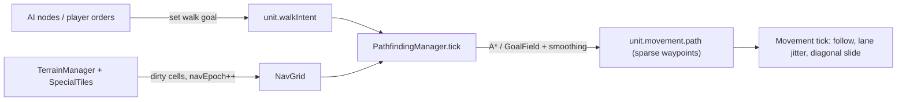

# Plan: Pathfinding overhaul

Design agreed in chat (2026-10-02). Goal: enemy units stop taking staircase / U-shaped routes, and pathfinding stays inside the frame budget from 1 up to ~200 units.

## Context — why paths look wrong today

| Symptom | Cause (verified by reading code, not by profiling) |
|---|---|
| "Stepping" staircase | AI paths are dense 8-connected cell lists and movement walks cell centre → cell centre (`game/units/unitMovementTick.ts`). Nothing smooths grid paths. |
| U-shapes / trailing kinks | `applyAIMovementToPosition` (`game/units/unitAI/utils.ts`) splices a sub-path from the **old path end** to the new destination, and rotates the destination by a jitter angle. Most enemies also path with an occupancy cost (`GameEngine.buildAIContext → findGridPathWithOccupancyCost`) that detours around crowds. |
| Cost | The occupancy variant is never cached; the A* open set is a linear-scan array with a `find` per neighbour; blocked cells are string-keyed sets; `getCrystalProtectedSet()` is rebuilt per request. |
| Line of sight | `TerrainGrid.hasLineOfSight` and `playerMovePath.isDirectGridLineTraversable` read **bedrock only** (ignore created rocks) and sample cells rather than covering every cell the line touches. |

## Decisions (locked)

| Topic | Decision |
|---|---|
| Location | New isolated folder `app/js/games/minion_battles/pathfinding/`. Nothing in it imports from `game/units/unitAI/` or mutates unit positions. |
| Separation | **AI sets a goal** (`unit.walkIntent`). **`PathfindingManager` turns goals into `unit.movement.path`.** **Movement only follows waypoints.** Movement never searches; pathfinding never moves a unit. |
| Path format | `movement.path` stays `{col,row}[]` but becomes **sparse waypoints** (string-pulled). Checkpoint + order wire formats unchanged. A one-waypoint path = straight line. |
| Unit collisions | Search **ignores other units** — occupancy cost is removed from pathfinding. `CellOccupancyManager` capacity, `CrowdSpacingManager`, and the movement-time **diagonal slide** (`unitCellSlide.ts`) stay and must keep working with sparse waypoints. |
| Tick order | Unchanged (abilities → occupancy → **pathfinding** → movement → crowd spacing → AI). Terrain is frozen for the pathfinding + movement phase. |
| Large units | Deferred. Every unit is assumed to fit a one-cell corridor. Do not add clearance classes. |
| Spreading | No cross-referencing between units. Per-unit `moveJitter` drives (1) left/right tie-break between near-equal routes, (2) corner widening during smoothing, (3) the existing in-cell jitter in movement. |

### Vocabulary

| Term | Meaning |
|---|---|
| **NavGrid** | Typed-array snapshot of passability + integer step cost per **nav profile**, derived from effective terrain. |
| **Nav profile** | `default` (terrain only) or `enemy` (terrain + crystal-protected cells blocked). Chosen from the unit, never stored on it. |
| **navEpoch** | Serialized integer that increments whenever passability/cost of any cell changes for any profile. |
| **Line of walk** | A straight segment is walkable: every cell it touches is passable and it never squeezes diagonally between two blocked cells. |
| **GoalField** | Goal-rooted Dijkstra distance field, expanded lazily, shared by every unit heading for the same goal cell. |
| **Walk goal** | The durable `unit.walkIntent`: chase a unit, or go to a cell / pixel. |

---

## Agent Instructions

This plan is executed by `/jp-implement-plan` (see `.claude/skills/jp-implement-plan/SKILL.md` — do not restate its workflow here). The **invoking agent is the sole orchestrator**: it spawns one worker per step **synchronously** (never in the background), waits for each worker to finish, then moves to the next step, and finally reports plan completion to the user. Each worker implements **exactly one step**, checks off that step's checklist items with a one-line summary under each, and **stops without spawning the next agent**.

Project skills relevant to this plan:

- `working-on-minion-battles` — where game code lives.
- `game-engine` — tick loop, manager wiring, checkpoint serialization.
- `working-on-ai-controllers` — AI trees/nodes (Steps 8–10).
- `game-sync-data-flow` — lockstep / checkpoint restore constraints (read before Steps 1, 6, 7).
- `ability-tests` — scenario definitions and the headless runner.
- `performance-debugging` — perf labels and the stress benchmark (Steps 6, 12).
- `scoped-testing` — per-step Vitest selection.
- `writing-nested-agents-files` — `pathfinding/AGENTS.md` (Step 11).

**Verification cadence:** per step, at most `npm run lint`, `npx tsc --noEmit` when the step crosses an interface boundary, and **only** the test files listed under that step's "Verify". No full-suite, whole-directory, or AbilityTest runner pass inside Steps 1–11. Step 12 runs the expensive checks once.

**Determinism rule (applies to every step).** The sim is deterministic lockstep and clients restore from checkpoints with **empty caches**. Therefore:

- Every path must be a pure function of serialized state: terrain, special tiles, unit position, walk goal, `moveJitter`, `gameTick`, `navEpoch`.
- Caches may only **memoize** — a cache hit and a cold rebuild must return identical results.
- No wall-clock budgets, no `Math.random`, no hidden runtime queues. Scheduling state lives on the unit and is serialized.
- Use **integer costs** (cardinal `10 × weight`, diagonal `14 × weight`, rounded) and break heap ties by `(cost, cellIndex)`.
- Never pick a search strategy based on cache contents or request counts. Strategy is chosen from the goal kind only: **chase-unit goals use GoalField; cell/pixel goals use A\***.

**Content note:** do not reorder tick phases, add large-unit clearance, add path costs for other units, or change order wire types. If a step seems to require one of these, stop and return the question.

---

## Architecture

**Folder layout (target):**

| File | Owns |
|---|---|
| `pathfinding/NavGrid.ts` | Per-profile `Uint8Array` passable + `Uint16Array` step cost, dirty-cell flush, connected-component labels. |
| `pathfinding/navProfile.ts` | `NavProfileId`, `getNavProfileForUnit(unit)`. |
| `pathfinding/lineOfWalk.ts` | Exact grid traversal (`hasLineOfWalk`). |
| `pathfinding/search/BinaryHeap.ts`, `search/aStar.ts` | Allocation-free point-to-point search. |
| `pathfinding/search/GoalField.ts` | Lazy, resumable goal-rooted Dijkstra + chain extraction. |
| `pathfinding/smoothing.ts` | String-pull a cell chain into sparse waypoints; corner widening. |
| `pathfinding/PathQuery.ts` | Stateless-looking facade: `findPath(from, to, profile, seed?)`, `isReachable`, `hasLineOfWalk`. Owns memo caches keyed by `navEpoch`. |
| `pathfinding/PathfindingManager.ts` | Per-tick phase: validate, schedule, plan, write `unit.movement`. |
| `pathfinding/AGENTS.md` | Module guide. |

**Tick placement:** a new phase in `UnitManager.gameTick` between Phase 2a (occupancy) and Phase 2b (movement), measured under a new `PERF_UNITS_PATHFINDING` label.

**Starter constants (tune in Step 12, record final values in `pathfinding/AGENTS.md`):**

| Constant | Starter | Notes |
|---|---|---|
| `MAX_PLANS_PER_TICK` | 24 | Count-based budget; unserved units stay due. |
| `CHASE_REPATH_BASE_TICKS` / `_JITTER_TICKS` | 12 / 12 | `nextRepathTick = tick + base + floor(moveJitter × jitter)`. |
| `EPOCH_RECHECK_STAGGER_TICKS` | 30 | After a terrain change, unblocked paths re-plan within this window. |
| `CHASE_GOAL_SLACK_DIVISOR` | 8 | Re-goal when target moved ≥ `max(1, floor(cellDistance / 8))` cells from `walkIntent.dest`. |
| `GOAL_FIELD_CACHE_SIZE` | 16 | LRU; cleared on `navEpoch` change. |
| `ROUTE_TIE_EPSILON` | 4 | Integer cost units (~0.4 cell) within which the seeded side bias may choose. |
| `CORNER_WIDEN_MAX_CELLS` | 2 | Max outward shift of a corner waypoint. |

---

### Step 1: NavGrid, nav profiles, and serialized `navEpoch`

**Touches:** `pathfinding/NavGrid.ts` (new), `pathfinding/navProfile.ts` (new), `pathfinding/NavGrid.test.ts` (new), `terrain/TerrainManager.ts`, `game/managers/SpecialTileManager.ts`, `game/types.ts`, `game/GameEngine.ts` (toJSON/fromJSON only).

**Verify:** `npm run lint`, `npx tsc --noEmit`, `npx vitest run app/js/games/minion_battles/pathfinding/NavGrid.test.ts`.

- [ ] Create `NavGrid` with per-profile passability and integer step cost.
  - Built from `TerrainManager.getEffectiveTerrainType` (bedrock + floor layer) and `TERRAIN_PROPERTIES[..].passable` / `pathfindingWeight`.
  - `enemy` profile additionally blocks cells from `SpecialTileManager.getCrystalProtectionMap()`; build that mask once per rebuild, not per query.
  - API: `isPassable(profile, col, row)`, `stepCost(profile, idx)`, `markDirty(col, row)`, `markAllDirty()`, `flush()` (re-derives dirty cells; cheap no-op when clean), `width/height`. Out-of-bounds = impassable.
  - Lazily computed connected-component labels per profile (8-connected with the diagonal corner rule), invalidated on flush-with-changes. Expose `sameComponent(profile, idxA, idxB)`.
- [ ] Add `navProfile.ts`: `NavProfileId = 'default' | 'enemy'` and `getNavProfileForUnit(unit)` (`enemy` when `areEnemies(unit.teamId, 'player')`, matching today's `findGridPathForUnit`).
- [ ] Add serialized `navEpoch` owned by `TerrainManager`.
  - `TerrainManager` owns the `NavGrid` instance (`terrainManager.nav`) and `navEpoch: number`.
  - Bump `navEpoch` + `markDirty` **only when effective passability or weight actually changes**: `createOrMarkRock`, rock destroyed in `damageRock` (not on every damage tick), `consumeRockInRadius`.
  - `clearPathCache()` stays as a compatibility entry point: `markAllDirty()` + epoch bump (tests mutate `tm.grid.set` directly and then call it or build paths fresh).
  - In `SpecialTileManager`, bump the epoch + `markAllDirty()` when a `Crystal` tile is added or removed (`addSpecialTile`, the `hp <= 0` splice in `damageSpecialTile`). Grep for any other place that mutates `specialTiles` and cover it.
  - Add `navEpoch?: number` to `SerializedGameState`; write it in `toJSON`, restore in `fromJSON` (default `0`), and `markAllDirty()` after `setTerrainLayers` on restore.
- [ ] Tests: profile masks (created rock blocks both profiles; crystal radius blocks `enemy` only), epoch bumps only on real passability change, component labels split by a wall and rejoin when the rock is destroyed, `flush()` after a single dirty cell equals a full rebuild.

### Step 2: Line of walk, heap A*, and smoothing (pure modules)

**Touches:** `pathfinding/lineOfWalk.ts`, `pathfinding/search/BinaryHeap.ts`, `pathfinding/search/aStar.ts`, `pathfinding/smoothing.ts`, plus one co-located `*.test.ts` per module (all new).

**Verify:** `npm run lint`, `npx vitest run app/js/games/minion_battles/pathfinding/`.

- [ ] `hasLineOfWalk(nav, profile, x0, y0, x1, y1)` in world pixels.
  - Supercover / DDA traversal: test **every** cell the segment touches.
  - When the traversal steps diagonally through a cell corner, both orthogonal neighbours must be passable (same rule as `isValidAdjacentPathStep`).
  - Also export the cell-centre variant `hasLineOfWalkCells(nav, profile, c0, r0, c1, r1)`.
  - Tests: clear open line; blocked by a single rock; diagonal squeeze between two rocks is rejected; line grazing a corner is rejected; zero-length line.
- [ ] `BinaryHeap` over cell indices with an external integer key array; ties broken by lower cell index. No per-push allocation.
- [ ] `aStar(nav, profile, startIdx, goalIdx, side)` returning a cell-index chain (start excluded) or `null`.
  - Typed arrays (`g`, `parent`, closed stamps) reused across calls via a generation counter — no per-search clearing or allocation.
  - Integer costs per the determinism rule; octile heuristic in the same integer units.
  - `side` (0 | 1) mirrors the neighbour iteration order so equal-cost routes resolve left or right. Same inputs ⇒ same chain.
  - Returns `null` immediately when `!nav.sameComponent(...)`.
  - Tests: straight corridor, detour round a wall, unreachable returns `null` without expanding, no diagonal corner cutting, `side` 0 vs 1 give mirrored routes round a symmetric obstacle, weighted terrain is avoided when a cheaper route exists.
- [ ] `smoothPath(nav, profile, startX, startY, chain)` → sparse `{col,row}[]`.
  - Greedy string-pull: from the anchor (first the unit's real position, then waypoint centres) keep extending while `hasLineOfWalk` holds; emit the last visible cell as a waypoint.
  - Do not shortcut across cells whose step cost exceeds the max step cost on the replaced chain segment (keeps weighted-terrain avoidance).
  - The final chain cell is always the last waypoint.
  - Tests: open-field diagonal collapses to **one** waypoint; L-shaped corridor yields exactly the corner + goal; a chain hugging a wall keeps the corner; every consecutive output pair satisfies `hasLineOfWalkCells`.

### Step 3: Movement follows sparse waypoints

**Touches:** `game/units/unitMovementTick.ts`, `game/units/unitCellSlide.ts`, `game/units/unitTypes.ts`, `game/units/unitMovementTick.sparse.test.ts` (new), `game/units/unitMovementTick.cornerCut.test.ts`.

**Verify:** `npm run lint`, `npx tsc --noEmit`, `npx vitest run app/js/games/minion_battles/game/units/unitMovementTick.sparse.test.ts app/js/games/minion_battles/game/units/unitMovementTick.cornerCut.test.ts app/js/games/minion_battles/game/units/Unit.test.ts`.

Movement must work for **both** dense and sparse paths after this step (the path source switches in Step 4).

- [ ] Make the diagonal slide independent of path density.
  - Today `checkNextCellOccupancy` runs when a path node is reached and assumes `path[0]` is adjacent. Replace with a **cell-crossing** check: each movement tick, compute the cell the unit would enter this step; if it differs from the current cell, the unit is occupancy-managed and not a shover, and `!canEnter(nextCell)`, call `findSlideCell(current, nextCell, …)`.
  - `findSlideCell` must additionally require the candidate to be passable and not a corner-cutting diagonal (use `terrainManager.nav`, unit's profile).
  - On a successful slide, `path.unshift(slideCell)` (a detour waypoint, not a replacement) and set `movement.navEpoch = -1` so the manager re-validates the remaining path (field added in Step 6; add it to `UnitMovement` now as optional).
  - No slide available ⇒ behave as today (proceed).
- [ ] Final-waypoint steering for pursuit: when `path.length === 1`, `movement.targetUnitId` is alive, and the target's cell is within Chebyshev distance 1 of `path[0]`, steer at the target's live position instead of the jittered cell centre.
- [ ] Add optional `stopRange?: number` (px) to `UnitWalkIntent` and `UnitMovement`. In the existing pursuit-stop block use `stopRange` when present, else the current `radius + radius + MIN_FOLLOW_RADIUS`. Serialize/restore it wherever `walkIntent` / `movement` are serialized (`unitToJSON.ts`, `unitFromJSON.ts`).
- [ ] Tests: a unit given a single far waypoint across open ground walks a straight line; a managed unit whose next cell is full slides diagonally and then resumes toward the original waypoint; a slide never selects an impassable cell; pursuit with one waypoint tracks a target that moves within the adjacent cell; existing corner-cut test still passes.

### Step 4: Swap the legacy pathfinder internals

**Touches:** `pathfinding/PathQuery.ts` (new) + test, `terrain/Pathfinding.ts`, `terrain/TerrainManager.ts`, `terrain/playerMovePath.ts`, `terrain/playerMovePath.test.ts`, `terrain/TerrainGrid.ts` (comment only), `game/GameEngine.ts` (`buildAIContext`), `testing/scenarios/general/pathfinding.ts`, `testing/scenarios/registry.ts`.

**Verify:** `npm run lint`, `npx tsc --noEmit`, `npx vitest run app/js/games/minion_battles/pathfinding/ app/js/games/minion_battles/terrain/playerMovePath.test.ts app/js/games/minion_battles/game/units/unitAI/DefaultAITree.test.ts`.

This is the step that removes the staircase for every existing caller, before any AI is migrated.

- [ ] `PathQuery`: `findPath(fromX, fromY, toCol, toRow, profile, side)` = line-of-walk fast path (returns `[goal]`) → else `aStar` → `smoothPath`. Also `findCellPath(fromCol, fromRow, …)` (anchors at the cell centre), `isReachable`, `hasLineOfWalk`, `nearestPassable(profile, col, row)` (replaces `findNearestPassable*`). Memoize `findCellPath` by `(profile, side, fromIdx, toIdx)`; drop the memo when `navEpoch` changes.
- [ ] Reduce `terrain/Pathfinding.ts` to a thin adapter over `PathQuery`: `findGridPath`, `findGridPathWithBlocked`, `findGridPathWithOccupancyCost` keep their signatures. `WithBlocked` maps to the `enemy` profile; `WithOccupancyCost` **ignores** the cost function. Delete the three A* copies, `smoothPath`, private LOS, and the string-keyed caches. Keep world-space `findPath` only if it still has callers (grep first).
- [ ] `GameEngine.buildAIContext.findGridPathForUnit` → one call: `PathQuery.findCellPath` with `getNavProfileForUnit(unit)` and `side = unit.moveJitter < 0.5 ? 0 : 1`. `hasLineOfSight` stays as is (projectile/perception semantics, not walkability).
- [ ] `playerMovePath.ts`: replace `isDirectGridLineTraversable`'s bedrock Bresenham with `hasLineOfWalkCells` on the `default` profile (fixes created rocks being ignored). Keep the exported function names.
- [ ] Update existing tests/scenarios that asserted dense cell-by-cell paths to assert on sparse waypoints / arrival instead.
- [ ] Add AbilityTest scenario definitions (registered; **run only in Step 12**):
  - `path_open_field_straight` — enemy chasing across open ground at an off-axis angle: max perpendicular deviation from the start→target line stays under half a cell.
  - `path_corner_no_backtrack` — target behind an L-shaped wall: the unit's distance-travelled is within ~15% of the smoothed shortest route (no U-shape).

### Step 5: GoalField

**Touches:** `pathfinding/search/GoalField.ts` (new), `pathfinding/search/GoalField.test.ts` (new), `pathfinding/PathQuery.ts`.

**Verify:** `npm run lint`, `npx vitest run app/js/games/minion_battles/pathfinding/search/GoalField.test.ts`.

- [ ] `GoalField(nav, profile, goalIdx)`: integer-cost Dijkstra rooted at the goal that **pauses and resumes**.
  - `ensureSettled(cellIdx)` continues the same expansion sequence until that cell is settled or the heap is empty. `distance(cellIdx)` returns the settled distance or `-1` (unreachable).
  - Check `nav.sameComponent` first so unreachable queries never expand.
- [ ] `extractChain(fromIdx, side)`: descend by distance to the goal.
  - Only step to neighbours with strictly lower distance (guarantees termination) and respect the diagonal corner rule.
  - Among neighbours within `ROUTE_TIE_EPSILON` of the best, prefer by `side`-mirrored neighbour order.
  - Uses distances only (never parent pointers), so the result is independent of expansion history.
- [ ] `PathQuery.findPathToSharedGoal(fromX, fromY, goalCol, goalRow, profile, side)`: line-of-walk fast path → else `GoalField` (LRU of `GOAL_FIELD_CACHE_SIZE`, cleared on `navEpoch` change) → `extractChain` → `smoothPath`.
- [ ] Tests: distances equal A* cost for sampled cells; **lazy vs fully-expanded field give identical chains**; **a field queried near-then-far equals one queried far-then-near**; unreachable returns `null` with zero expansions; LRU eviction + rebuild returns the identical path; `side` splits two units round a symmetric obstacle.

### Step 6: PathfindingManager — goals in, paths out

**Touches:** `pathfinding/PathfindingManager.ts` (new) + test, `game/units/Unit.ts`, `game/units/unitTypes.ts`, `game/units/unitToJSON.ts`, `game/units/unitFromJSON.ts`, `game/units/unitMovementTick.ts`, `game/managers/UnitManager.ts`, `game/EngineContext.ts`, `game/GameEngine.ts`, `game/performance/tickPerformanceTracker.ts`.

**Verify:** `npm run lint`, `npx tsc --noEmit`, `npx vitest run app/js/games/minion_battles/pathfinding/PathfindingManager.test.ts app/js/games/minion_battles/game/units/Unit.test.ts app/js/games/minion_battles/game/units/unitMovementTick.sparse.test.ts`.

- [ ] Unit state (all serialized):
  - `unit.nextRepathTick: number` (default `0`).
  - `UnitMovement.navEpoch: number` — epoch the path was planned/validated at.
  - `unit.setWalkGoal(goal)` where goal is `{ kind: 'unit', unitId, stopRange? } | { kind: 'cell', col, row, targetPixel? }`. It writes `walkIntent`; if the goal **materially changed** (different target unit, or different dest cell / pixel) it calls `invalidateMovementPath()`; otherwise it is a no-op. `unit.clearMovement()` remains "stop".
- [ ] `PathfindingManager.tick(units, engine)`, wired into `UnitManager.gameTick` as a new phase between occupancy (2a) and movement (2b), under `PERF_UNITS_PATHFINDING`.
  - First `terrainManager.nav.flush()`.
  - Iterate units starting at index `gameTick % units.length` (deterministic rotation, prevents starvation). Skip dead / inactive / spawning / `movementPaused` / `abilityOwnsMovementThisTick` / effective speed `<= 0` / no `walkIntent`.
  - A unit **needs a plan** when it has an intent and (`pathInvalidated` or no live path). Plan up to `MAX_PLANS_PER_TICK` per tick; the rest are picked up on later ticks (their state already says "needs a plan").
  - Planning: `kind: 'unit'` → `findPathToSharedGoal` toward the target's current cell (update `walkIntent.dest`); `kind: 'cell'` → `PathQuery.findPath`. Write via `setUnitMovement` and stamp `movement.navEpoch = terrainManager.navEpoch`, `nextRepathTick`.
  - Unreachable ⇒ keep the intent, leave `movement = null`, `pathInvalidated = true`, and set `nextRepathTick = tick + CHASE_REPATH_BASE_TICKS + jitter` so it is not retried every tick. An unreachable unit only retries when `tick >= nextRepathTick` or the epoch changed.
- [ ] Remove pathfinding from movement and UnitManager: delete `tryRepathFromWalkIntent` from `unitMovementTick.ts` and `refreshPlayerPursuitPath` from `UnitManager.ts`; the manager now covers both (player pursuit = a `kind: 'unit'` goal already present in `walkIntent.targetUnitId`). Keep the same-cell `targetPixel` arrival behaviour.
- [ ] Expose `pathfinding: PathfindingManager` and `pathQuery` on `EngineContext`; clear caches in `prepareForNewGame` / `fromJSON` (never serialize them).
- [ ] Tests: goal set in tick T produces a path in T+1; knockback-invalidated unit re-plans from its new position; budget — 60 units needing plans with a budget of 24 are all planned within 3 ticks and none is skipped twice; unreachable goal does not re-search every tick; **determinism** — run N ticks, checkpoint via `toJSON`/`fromJSON` into a fresh engine mid-run, continue both, and assert identical unit positions/paths (or `Fingerprint`) after M more ticks.

### Step 7: Path updating — validate, trim, stagger, chase refresh

**Touches:** `pathfinding/PathfindingManager.ts`, `pathfinding/PathfindingManager.update.test.ts` (new), `pathfinding/PathQuery.ts`.

**Verify:** `npm run lint`, `npx vitest run app/js/games/minion_battles/pathfinding/`.

All of these run inside the manager's per-unit pass and count against `MAX_PLANS_PER_TICK` only when they trigger a search.

- [ ] **Terrain-change validation.** When `movement.navEpoch !== terrainManager.navEpoch`: walk the remaining path (unit position → `path[0]` → …) with `hasLineOfWalk`. Blocked ⇒ invalidate (re-plan this tick, budget permitting). Clear ⇒ stamp the new epoch and set `nextRepathTick = tick + floor(moveJitter × EPOCH_RECHECK_STAGGER_TICKS)` so a newly opened shortcut is picked up, staggered.
- [ ] **Shortcut trim.** When a unit's `nextRepathTick` comes due and its path has ≥ 2 waypoints: drop leading waypoints while a later waypoint has line of walk from the unit's position. No search.
- [ ] **Chase refresh.** For `kind: 'unit'` goals each tick (cheap integer check): if the target's cell is ≥ `max(1, floor(chebyshevCells(unit, target) / CHASE_GOAL_SLACK_DIVISOR))` cells from `walkIntent.dest`, mark the unit as needing a plan. Otherwise, when `nextRepathTick` is due, do the shortcut trim only. Near units therefore re-goal promptly; far units keep sharing the old goal's cached field.
- [ ] **Direct line of sight.** Confirm via test that whenever line of walk to the target exists at plan time, the result is a single waypoint and no search structure is touched (spy on `aStar` / `GoalField` construction).
- [ ] Tests: rock created across a path ⇒ only that unit re-plans, others just re-stamp; rock destroyed ⇒ units adopt the shortcut within the stagger window, not all on one tick; 100 units chasing one moving target build at most one `GoalField` per distinct goal cell; restored-from-checkpoint engine makes the same validate/re-plan decisions as the original (extend the Step 6 determinism test with a terrain change).

### Step 8: Intent-based AI API + core trees

**Touches:** `game/units/unitAI/types.ts`, `game/units/unitAI/utils.ts`, `game/GameEngine.ts` (`buildAIContext`), `unitAI/default/*`, `unitAI/aggroWander/*`, `unitAI/alphaWolfBoss/*`, `unitAI/hunt/*`, `unitAI/DefaultAITree.test.ts`.

**Verify:** `npm run lint`, `npx tsc --noEmit`, `npx vitest run app/js/games/minion_battles/game/units/unitAI/DefaultAITree.test.ts`.

- [ ] Add `AIContext.nav`: `chaseUnit(unit, target, opts?: { stopRange?: number })`, `moveToCell(unit, col, row)`, `moveToPoint(unit, x, y)`, `stop(unit)`, `isReachable(unit, col, row)`, `hasLineOfWalk(unit, x, y)`. All but the two queries only call `unit.setWalkGoal` / `clearMovement`. Keep `findGridPathForUnit` on the context until Step 10 so unmigrated trees still compile.
- [ ] Rewrite `applyAIMovementToPosition` / `applyAIMovementToUnit` on top of `nav`:
  - `dist > maxRange` ⇒ `chaseUnit(target, { stopRange: idealRange })` (or `moveToPoint` for a position target).
  - `dist < minRange` ⇒ `moveToPoint` to the retreat point (clamped to world bounds; if `!isReachable`, do nothing).
  - In range ⇒ leave the current goal alone.
  - Delete the path-splice logic and the destination angle jitter. Drop the `findGridPath` / `worldToGrid` / `gameTick` params.
- [ ] Migrate `default` (attack, idle, findLight, wander, siegeDefendPoint), `aggroWander`, `alphaWolfBoss`, `hunt` nodes: replace every `findGridPathForUnit` + `setMovement` pair with a `nav` call. Where a node used "did a path come back?" to choose among candidates (wander / findLight), use `nav.isReachable`. Delete `onPathfindingRetrigger` handlers that only re-pathed; keep any non-path logic by moving it into `execute` behind `everyAITicks`.
- [ ] Update `DefaultAITree.test.ts` mocks/assertions from "path was set" to "walk goal was set" (and, where the test drives an engine, "unit arrives").

### Step 9: Migrate network and patrol trees

**Touches:** `unitAI/networkHunt/*`, `unitAI/swarmlingNetwork/*`, `unitAI/lanterniteNetwork/*`, `unitAI/lanternitePatrol/*`, `nh_travel.test.ts`, `snet_seek.test.ts`.

**Verify:** `npm run lint`, `npx tsc --noEmit`, `npx vitest run app/js/games/minion_battles/game/units/unitAI/networkHunt/nh_travel.test.ts app/js/games/minion_battles/game/units/unitAI/swarmlingNetwork/snet_seek.test.ts`.

- [ ] `networkHunt` (`nh_travel`, `nh_engage`): hop targets become `nav.moveToPoint(stepTarget)`; engage becomes `nav.chaseUnit`. Because `setWalkGoal` is a no-op for an unchanged goal, `execute` may call it every AI turn — remove the `needsNewPath` guards and the retrigger handlers.
- [ ] `swarmlingNetwork` (`snet_seek`, `snet_hunt`) and `lanterniteNetwork` (`lnet_chase`, `lnet_guard`, `lnet_scout_travel`, `lnet_scout_construct`), `lanternitePatrol` (`lantern_patrol`): same conversion.
- [ ] Update the two test files to the goal-based assertions.

### Step 10: Migrate pets, remove the legacy AI path API

**Touches:** `unitAI/pet/*`, `pet_engage.test.ts`, `abilities/petCommands.ts`, `unitAI/types.ts`, `unitAI/runner.ts`, `unitAI/index.ts`, `game/GameEngine.ts`, `game/managers/UnitManager.ts`, `game/units/Unit.ts`, `unitAI/SKILL.md`.

**Verify:** `npm run lint`, `npx tsc --noEmit`, `npx vitest run app/js/games/minion_battles/game/units/unitAI/`.

- [ ] Migrate `pet_follow`, `pet_heel`, `pet_return`, `pet_ordered_move`, `pet_guardWander`, `pet_engage`, and the two `findGridPath` uses in `abilities/petCommands.ts` to walk goals.
- [ ] Remove `findGridPathForUnit` and `terrainManager.findGridPath` from `AIContext`; remove `AINodeActions.onPathfindingRetrigger`, `runPathfindingRetrigger`, and the retrigger block in `UnitManager.gameTick`. Stop assigning `pathfindingRetriggerOffset` in `addUnit`; keep the `moveJitter` assignment exactly as is. The player branch's `generateRandomInteger(30, 90)` call can be removed with the field (all clients run the same build, so the RNG sequence shifting is safe). Leave `fromJSON` tolerant of the old field.
- [ ] `npx tsc --noEmit` must show no remaining references; grep for `findGridPathForUnit`, `onPathfindingRetrigger`, `pathfindingRetriggerOffset` (scenario files that set it to `0` to silence the AI can drop the line).
- [ ] Update `unitAI/SKILL.md`: nodes set goals through `context.nav`; they never request or store paths.

### Step 11: Spreading, cleanup, docs

**Touches:** `pathfinding/smoothing.ts` + test, `pathfinding/PathQuery.ts`, `pathfinding/PathfindingManager.ts`, `terrain/Pathfinding.ts` (delete or shrink), `terrain/TerrainManager.ts`, `pathfinding/AGENTS.md` (new), `terrain/AGENTS.md`, `minion_battles/AGENTS.md`, `testing/scenarios/general/pathfinding.ts`, `testing/scenarios/registry.ts`.

**Verify:** `npm run lint`, `npx tsc --noEmit`, `npx vitest run app/js/games/minion_battles/pathfinding/`.

- [ ] **Corner widening** in `smoothPath(…, lane)` where `lane = unit.moveJitter` (0..1): for each interior (corner) waypoint, find the outward direction (away from the blocking cell it wraps), count free cells outward up to `CORNER_WIDEN_MAX_CELLS`, and shift the waypoint `floor(lane × (free + 1))` cells outward. Accept the shift only if line of walk still holds to the previous anchor and the next waypoint; otherwise keep the original. In a one-wide corridor `free = 0` ⇒ no shift (units go single file).
- [ ] Pass `side` and `lane` from the manager for every plan; make the `findCellPath` memo key include the quantised lane only if profiling shows it matters — default: memoize the **cell chain** (keyed without lane) and run the cheap smoothing per unit.
- [ ] Delete what is left of the legacy pathfinder: remove `terrain/Pathfinding.ts` if nothing imports it, otherwise leave only the delegating methods on `TerrainManager` (`findGridPath` for UI previews). Remove `CellOccupancyManager.getOccupancyCost` if unused.
- [ ] Write `pathfinding/AGENTS.md` (module map, the determinism rule verbatim, tick placement, constants table, "movement never searches / pathfinding never moves"). Update `terrain/AGENTS.md`'s "Pathfinding helpers" row and add a pointer in `minion_battles/AGENTS.md`.
- [ ] Add AbilityTest scenario definitions (run in Step 12):
  - `path_group_spreads` — 12 units chase one target round a wide corner: at the corner, the units' positions span at least 2 cells perpendicular to travel (not a single file), and all arrive.
  - `path_chokepoint_slide` — a one-wide gap with stationary managed units in it: approaching units slide diagonally / queue and none ends inside impassable terrain.
  - `path_terrain_change_reroute` — a rock is created across the route mid-walk, then destroyed: the unit reroutes, then takes the shortcut again.
  - `path_stress_200` — 200 enemies chase 2 moving players on a map with obstacles for ~10 s of sim time: all make progress (mean distance to target decreases), no unit inside impassable terrain, and the scenario records the `PERF_UNITS_PATHFINDING` average and max per tick in `describeState`.

### Step 12: Final verification

**Touches:** `pathfinding/AGENTS.md` (constants only), this plan file.

- [ ] `npm run lint` and `npx tsc --noEmit` clean.
- [ ] `npm run test` (full Vitest suite) green; list any pre-existing failures separately.
- [ ] Run the AbilityTest scenarios once via the headless runner (see the `ability-tests` skill): all existing `Movement` / crowd-spacing / pet scenarios plus `path_open_field_straight`, `path_corner_no_backtrack`, `path_group_spreads`, `path_chokepoint_slide`, `path_terrain_change_reroute`, `path_stress_200`.
- [ ] Performance: from `path_stress_200`, record average and worst-tick pathfinding time in this plan. Target: average well under 1 ms/tick and no single tick over ~3 ms at 200 units on the dev machine. If missed, tune `MAX_PLANS_PER_TICK` / repath intervals / `CHASE_GOAL_SLACK_DIVISOR` (constants only) and re-run this item; write the final values into `pathfinding/AGENTS.md`.
- [ ] Manual browser checklist — **leave unchecked for the user** and list it in the completion report:
  - On mission `007_ember_threshold` (or any mission with rock corridors), enemies approaching the player take straight / gently bent routes — no staircase, no U-turns.
  - A pack of 10+ enemies fans out in open ground and narrows at a corridor without forming a single solid line elsewhere.
  - Enemies with direct line of sight walk straight at the player.
  - Player click-to-move, wait+move, and pursue-a-unit orders behave as before, including around created rocks.
  - Creating and destroying a rock in the enemies' route makes them reroute without visible stalls.
  - In a two-client lobby, play a few rounds with terrain changes and a mid-battle refresh on the non-host: no desync reported.
